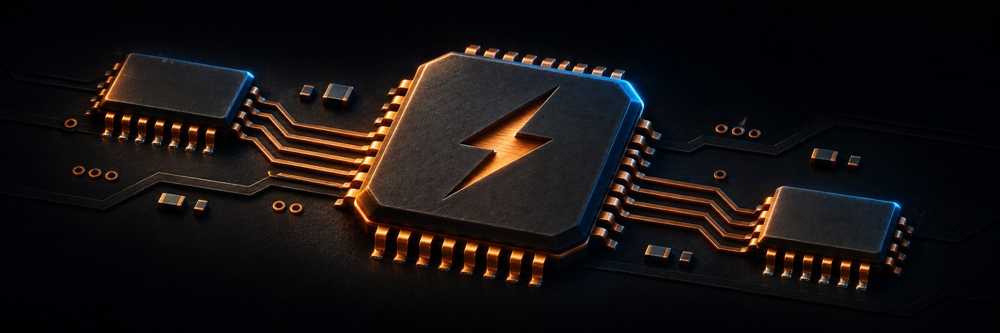

# FeraVolt · Local AI on older hardware

[Русский](README.ru.md) · [Hugging Face models](https://huggingface.co/TalasCloud)

I maintain portable builds and tools for local LLMs and generative media on older hardware. I work with NVIDIA Pascal and Tesla P40 over CUDA, AMD Polaris and RX 580 over Vulkan, Intel Ivy Bridge with AVX1, and Haswell with AVX2.

## Inference and model tools

| Project | Use it for |
|---|---|
| [Strata Desktop](https://github.com/aktalascloud/strata-legacy-gpu) | LLMs on Tesla P40 · local Swift 256K, CUDA and AVX1 |
| [pascallama.cpp](https://github.com/aktalascloud/pascallama.cpp) | llama.cpp DP4A / MMQ patches for Pascal |
| [KoboldCpp Core](https://github.com/aktalascloud/koboldcpp-avx2-vulkan-numa) | Haswell AVX2 + Polaris Vulkan runtime |
| [Polaris AI Toolkit](https://github.com/aktalascloud/polaris-gfx803-rx580-zluda-rocm-hip-comfyui-windows) | RX 580 toolkit for ZLUDA, HIP/ROCm and ComfyUI |
| [GGUF Converter](https://github.com/aktalascloud/gguf-converter) | Portable Windows conversion + Vulkan calibration |
| [KoboldCpp Media](https://github.com/aktalascloud/koboldcpp-media-pipeline) | Local API for images, video, music and sound |

## Interfaces and agents

| Project | Use it for |
|---|---|
| [Open WebUI AVX1](https://github.com/aktalascloud/open-webui-ivybridge-avx1) | Self-hosted interface for older Windows PCs |
| [Open WebUI Desktop AVX1](https://github.com/aktalascloud/open-webui-desktop-ivybridge-avx1) | Desktop client with isolated connections |
| [Open Terminal AVX1](https://github.com/aktalascloud/open-terminal-ivybridge-avx1) | Standalone terminal and agent service |
| [Conduit ARM64](https://github.com/aktalascloud/conduit-owui-cline-arm64-performance) | Open WebUI + native Cline on Android |
| [Cline Desktop AVX1](https://github.com/aktalascloud/cline-desktop-ivybridge-avx1) | Archived Ivy Bridge Windows client |

## Measured results

- **Tesla P40 · Strata.** One Swift IQ3_S request with 261,998 input tokens and 128 output tokens completed in 913.43 s without a cache read. [Evidence](https://github.com/aktalascloud/strata-legacy-gpu/blob/18f4ae56b074c39e6ff0c93e2458b47ced4857bc/legacy-p40/research/swift-20261118.json)
- **RX 580 · Polaris.** Synthetic 4096×4096 attention took 87.68 → 53.86 ms and 1,024 → 69 MiB in additional peak tensor allocations. [Evidence](https://github.com/aktalascloud/polaris-gfx803-rx580-zluda-rocm-hip-comfyui-windows/blob/1199364f36e2f855f6e4eda3fffc41fd68e70a5a/results.json)
- **RX 580 / Haswell · Media.** LightVAE-Pro saved 17 Wan frames in 30.53 s vs 33.04 s. The SA3 CPU worker processed three chunks of a 15-second effect in 21.57 s vs 26.53 s. Outputs matched byte for byte. [Evidence](https://github.com/aktalascloud/koboldcpp-media-pipeline/blob/24a912c4c35ee6ad38deea62a46a58730fa3ee84/docs/evidence/lowlevel-media-20261118.json)

## Models on Hugging Face

Calibrated GGUF, ONNX exports and original components. Model cards include upstream revisions, licenses, hashes and compatible runtimes.

[Images / Изображения](https://huggingface.co/collections/TalasCloud/local-images-6afd9cc548921799f88c2d87) · [Video / Видео](https://huggingface.co/collections/TalasCloud/local-video-on-vulkan-6afd9b6d8c5ee9466addcea8) · [Music / Музыка](https://huggingface.co/collections/TalasCloud/local-music-with-yue2-6afd9b6fc269428eae938690) · [Sound effects / Звуковые эффекты](https://huggingface.co/collections/TalasCloud/stable-audio-3-6afd9cc71fefb78485b7c2ee)
