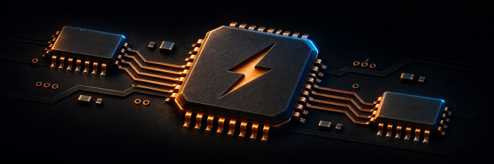

# FeraVolt · Локальный ИИ на доступном железе

[English](README.md) · [Модели Hugging Face](https://huggingface.co/TalasCloud)

Поддерживаю портативные сборки и инструменты для локальных LLM и медиамоделей. Работаю с NVIDIA Pascal и Tesla P40 через CUDA, AMD Polaris и RX 580 через Vulkan, Intel Ivy Bridge с AVX1 и Haswell с AVX2.

## Движки и модели

| Проект | Для чего |
|---|---|
| [Strata Desktop](https://github.com/aktalascloud/strata-legacy-gpu) | LLM на Tesla P40 · Swift 256K, CUDA и AVX1 |
| [pascallama.cpp](https://github.com/aktalascloud/pascallama.cpp) | Патчи DP4A / MMQ для llama.cpp на Pascal |
| [KoboldCpp Core](https://github.com/aktalascloud/koboldcpp-avx2-vulkan-numa) | Движок Haswell AVX2 + Polaris Vulkan |
| [Polaris AI Toolkit](https://github.com/aktalascloud/polaris-gfx803-rx580-zluda-rocm-hip-comfyui-windows) | RX 580 · ZLUDA, HIP/ROCm и ComfyUI |
| [GGUF Converter](https://github.com/aktalascloud/gguf-converter) | Конвертер GGUF и калибровка Vulkan для Windows |
| [KoboldCpp Media](https://github.com/aktalascloud/koboldcpp-media-pipeline) | Локальный API для изображений, видео, музыки и звука |

## Интерфейсы и агенты

| Проект | Для чего |
|---|---|
| [Open WebUI AVX1](https://github.com/aktalascloud/open-webui-ivybridge-avx1) | Интерфейс для локального запуска на старых ПК |
| [Open WebUI Desktop AVX1](https://github.com/aktalascloud/open-webui-desktop-ivybridge-avx1) | Настольный клиент с изоляцией подключений |
| [Open Terminal AVX1](https://github.com/aktalascloud/open-terminal-ivybridge-avx1) | Отдельный сервис терминала и агентов |
| [Conduit ARM64](https://github.com/aktalascloud/conduit-owui-cline-arm64-performance) | Open WebUI + нативный Cline на Android |
| [Cline Desktop AVX1](https://github.com/aktalascloud/cline-desktop-ivybridge-avx1) | Архивная сборка для Windows на Ivy Bridge |

## Что измерено

- **Tesla P40 · Strata.** Один запрос Swift IQ3_S с 261 998 токенами на входе и 128 на выходе прошёл без чтения кэша за 913,43 с. [Данные](https://github.com/aktalascloud/strata-legacy-gpu/blob/18f4ae56b074c39e6ff0c93e2458b47ced4857bc/legacy-p40/research/swift-20261118.json)
- **RX 580 · Polaris.** В синтетическом тесте attention 4096×4096 получено 87,68 → 53,86 мс и 1 024 → 69 МиБ дополнительных пиковых выделений тензоров. [Данные](https://github.com/aktalascloud/polaris-gfx803-rx580-zluda-rocm-hip-comfyui-windows/blob/1199364f36e2f855f6e4eda3fffc41fd68e70a5a/results.json)
- **RX 580 / Haswell · Media.** LightVAE-Pro сохранил 17 кадров Wan за 30,53 с вместо 33,04 с. SA3 на CPU обработал три чанка 15-секундного эффекта за 21,57 с вместо 26,53 с. Результаты совпали побайтно. [Данные](https://github.com/aktalascloud/koboldcpp-media-pipeline/blob/24a912c4c35ee6ad38deea62a46a58730fa3ee84/docs/evidence/lowlevel-media-20261118.json)

## Модели на Hugging Face

Калиброванные GGUF, ONNX и оригинальные компоненты. Карточки содержат ссылки на источники, лицензии, хеши и совместимые рантаймы.

[Images / Изображения](https://huggingface.co/collections/TalasCloud/local-images-6afd9cc548921799f88c2d87) · [Video / Видео](https://huggingface.co/collections/TalasCloud/local-video-on-vulkan-6afd9b6d8c5ee9466addcea8) · [Music / Музыка](https://huggingface.co/collections/TalasCloud/local-music-with-yue2-6afd9b6fc269428eae938690) · [Sound effects / Звуковые эффекты](https://huggingface.co/collections/TalasCloud/stable-audio-3-6afd9cc71fefb78485b7c2ee)
